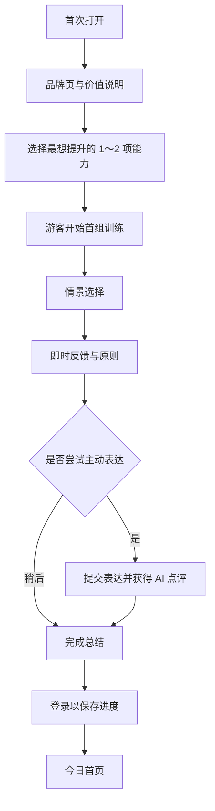

# 02 产品需求文档（PRD）

## 1. 产品概述

微习是一款面向碎片时间的技能微学习小程序。MVP 聚焦职场沟通与表达，通过真实情景、选择判断、解释反馈、原则总结、主动表达和间隔复习，帮助用户在每天约 3 分钟内完成一次有效训练。

### 1.1 版本目标

- 新用户无需理解复杂规则即可在 60 秒内进入第一道题；
- 单组训练可在 2～5 分钟内完成；
- 完成后明确知道“今天练了什么”和“下次什么时候回来”；
- 内容、进度和复习状态可持续更新；
- AI 服务不可用时，核心选择题训练仍可完成。

### 1.2 角色

| 角色 | 权限 |
| --- | --- |
| 游客 | 体验首组训练，数据仅本地临时保存，不可跨设备同步 |
| 登录用户 | 保存进度、复习、收藏、AI 点评、学习报告、分享 |
| 内容编辑 | 创建和编辑草稿、运行校验、提交审核 |
| 内容审核员 | 预览、退回、批准、发布、下架 |
| 运营管理员 | 管理课程展示、查看数据、处理反馈与风险内容 |

## 2. 需求优先级

使用 P0/P1/P2 表示版本优先级：

- P0：没有该能力，核心学习闭环不成立；
- P1：应在 MVP 首发具备，但可在小范围内以简化形态实现；
- P2：验证后迭代，不阻塞 MVP 发布。

| 模块 | 能力 | 优先级 |
| --- | --- | --- |
| 首次体验 | 游客直达首训、最小偏好选择 | P0 |
| 今日 | 今日任务、待复习数量、继续学习 | P0 |
| 训练 | 情景选择、反馈、原则、完成页 | P0 |
| 主动练习 | 输入表达、结构化 AI 点评、降级 | P1 |
| 课程 | 章节、课节、锁定与进度 | P0 |
| 复习 | 错题与到期复习调度 | P0 |
| 收藏 | 收藏原则卡、查看收藏 | P1 |
| 成长 | 连续天数、周完成进度 | P1 |
| 分享 | 无答案的情景挑战卡 | P1 |
| 账号 | 微信登录、数据同步、注销/删除 | P0 |
| 通知 | 用户主动订阅后的学习提醒 | P2 |
| 内容后台 | 草稿、校验、审核、发布、下架 | P0 |
| 运营数据 | 漏斗、留存、内容质量报表 | P0 |

## 3. 信息架构与导航

底部导航使用 3 个主入口，降低认知负担：

```text
今日
├── 今日训练
├── 待复习
└── 周进度

课程
├── 课程详情
├── 章节详情
└── 训练组

我的
├── 学习统计
├── 错题与收藏
├── 学习偏好
├── 反馈
└── 设置与隐私
```

搜索、专题和商业化入口不进入 MVP 主导航。

## 4. 核心用户流程



设计原则：先让用户体验价值，再请求登录；不在进入首题前索要昵称、头像、岗位、公司等非必要信息。

## 5. 功能需求

### 5.1 启动与首次引导

#### 页面目标

让用户快速理解产品并进入第一组训练。

#### 功能规则

1. 首屏展示品牌、主口号、示例情景和“立即练习”按钮；
2. 首次只询问最想提升的 1～2 项：清晰汇报、边界沟通、表达异议、推动协作；
3. 岗位、工作年限和提醒时间均可跳过；
4. 游客可完成一组完整训练；
5. 首组完成后提示登录保存，不登录仍可查看完成总结；
6. 重复打开时：有未完成训练则提示继续，无则进入今日页。

#### 验收要点

- 从首次打开到第一道题不超过 3 个主动操作；
- 用户拒绝授权不阻塞游客训练；
- 退出后再次进入可恢复到最近一张卡片；
- 偏好至少影响首周课程排序，不只是采集后闲置。

### 5.2 今日首页

#### 页面内容

- 问候与当日状态；
- 主任务卡：训练标题、预计 3 分钟、技能标签、开始/继续按钮；
- 待复习卡：到期数量，最多显示“5+”；
- 本周进度：完成天数，不展示压力型倒计时；
- 最近获得的能力反馈或课程进度。

#### 状态

| 状态 | 主任务行为 |
| --- | --- |
| 今日未开始 | 显示“开始今天的 3 分钟” |
| 训练中断 | 显示进度和“继续练习” |
| 今日已完成，有到期复习 | 显示完成状态，突出“复习 N 题” |
| 今日已完成，无复习 | 展示总结和下一课预告 |
| 内容加载失败 | 使用已缓存训练；无缓存时可重试并展示友好说明 |

“每天”以用户本地时区的自然日计算；跨时区时以服务端记录的用户时区为准，避免重复奖励。

### 5.3 训练组

一组训练由 1 个主题下的 4～6 张核心卡组成，推荐顺序：

1. 情景卡；
2. 选择卡；
3. 反馈卡；
4. 原则卡；
5. 主动表达卡（部分训练）；
6. 完成卡。

#### 情景与选择

- 情景包含关系、目标、限制和上下文，不依赖图片也能理解；
- 默认提供 3 个选项；
- 选择后立即锁定本题，避免根据反馈反复修改造成错误数据；
- 不用单一红/绿表达对错，同时显示文字标签；
- 反馈可标记“更推荐”“可用但有风险”“不建议”，而不必强行定义唯一正确答案；
- 每个选项解释“对方可能如何理解、优点、风险和适用条件”。

#### 原则卡

- 只总结 1 个可迁移原则；
- 建议结构为“边界 + 事实 + 下一步”；
- 支持收藏；
- 可查看一个简短的正反例；
- 不使用保证性或绝对化表述。

#### 完成条件

- 必须完成选择和反馈阅读；
- 主动表达可在 MVP 中跳过，不影响训练完成；
- 完成时写入学习记录并创建后续复习计划；
- 重复训练不重复增加当日完成天数，但记录新的作答结果。

### 5.4 主动表达与 AI 点评

#### 输入

- 用户根据变体场景输入一句 10～200 字的回复；
- 输入框上方提示“请勿填写真实姓名、公司机密或其他敏感信息”；
- 提供“换一个示例”和“暂时跳过”；
- 提交前进行长度、空文本和明显敏感信息规则检查。

#### 输出

点评只围绕预先定义的 3～4 个维度：

- 是否回应核心目标；
- 是否说明边界或事实；
- 是否给出明确下一步；
- 语气是否与关系匹配。

每个维度输出“已做到 / 可加强 / 未体现”及一句理由，再给出一个参考改写。避免人格评价、情绪诊断和“高情商/低情商”标签。

#### 服务降级

| 情况 | 处理 |
| --- | --- |
| 生成中 | 显示分阶段等待反馈，可取消 |
| 超过 8 秒 | 提示仍在生成，并允许稍后在结果页查看 |
| 超时或模型失败 | 返回基于规则的检查清单，不阻塞完成 |
| 输出格式不合法 | 服务端自动重试 1 次，仍失败则降级 |
| 命中安全策略 | 不生成改写，给出中性提示和反馈入口 |
| 达到每日额度 | 允许继续选择题训练，提示次日恢复 |

AI 点评结果与模型、提示词和评测版本关联，便于复现和下架。

### 5.5 课程路径

#### 展示规则

- 显示课程介绍、适用人群、章节、课节、预计总时长；
- 每个课节显示未开始、进行中、已完成、待复习四类状态；
- 完成前一课节后解锁下一课节；
- 用户偏好只影响推荐顺序，不跳过课程必要前置；
- 允许重练已完成内容；
- 内容下架时保留用户历史记录，但不再推荐或打开正文。

#### 首发课程大纲

| 章节 | 课节示例 |
| --- | --- |
| 清晰汇报 | 先说结论、说明进度、暴露风险、提出请求、形成闭环 |
| 边界沟通 | 拒绝临时任务、应对职责越界、管理时间预期、处理反复修改、协商优先级 |
| 提出不同意见 | 先确认目标、区分事实判断、提出风险、提供替代方案、会后补充 |
| 推动他人行动 | 明确责任人、定义截止时间、友好催办、升级风险、确认决策 |

### 5.6 复习

#### 进入复习池

以下内容创建复习项：

- 选择了“不建议”选项；
- 在关键维度表现为“可加强/未体现”；
- 用户主动收藏或标记“没掌握”；
- 课程规定的阶段综合题。

#### 调度规则（MVP）

- 首次答错：1 天后；
- 第一次复习正确：3 天后；
- 第二次复习正确：7 天后；
- 连续正确后：14 天后；
- 再次答错：回到 1 天间隔；
- 每日最多主动推送 5 个复习项，其余顺延；
- 同一训练的原题与变体优先交替，减少答案记忆。

#### 复习完成

- 复习单题控制在 20～45 秒；
- 即时展示简短解释；
- 完成后显示本次巩固的技能，不用夸大的“记忆力提升”结论。

### 5.7 错题与收藏

- 错题按技能标签和最近时间筛选；
- 收藏对象是原则卡，不默认保存用户原始输入；
- 用户可以取消收藏、重练和删除自己的主动表达记录；
- 内容更新后显示“内容已更新”，历史作答仍关联原版本。

### 5.8 成长与反馈

- 连续学习天数以完成至少一组正式训练或一次到期复习为准；
- 允许每周 1 次“轻松日”，不通过断签惩罚制造焦虑；
- 周报告只陈述行为和技能维度，不推断人格或职场能力等级；
- 报告包括完成天数、训练数、复习数、较稳定维度和建议练习维度；
- 学习提醒必须由用户主动订阅，拒绝后不重复打扰。

### 5.9 分享

#### 分享内容

- 情景题干；
- 3 个选项（可在落地页答题）；
- 微习品牌与课程标签；
- 不包含正确答案、用户错误率和用户输入。

#### 落地行为

1. 好友打开后可直接答题；
2. 作答后查看简版反馈；
3. 可继续体验完整首组训练；
4. 分享来源只用于归因，不自动建立好友关系。

### 5.10 我的与账号

- 展示学习统计、错题、收藏和课程进度；
- 可修改学习偏好；
- 可提交内容错误、产品建议或不当内容反馈；
- 可查看用户协议、隐私政策、AI 功能说明；
- 支持导出或删除用户生成内容的说明入口；
- 支持注销账号，注销前说明将删除/匿名化的范围与处理时间。

### 5.11 内容后台

后台可先作为内部 Web 管理工具，不需要在小程序内实现。

#### 最小功能

- 课程、章节、课节、训练、卡片的增删改查；
- JSON 编辑与表单编辑；
- AI 生成候选内容；
- 自动校验：字段完整、长度、重复、敏感词、选项分布；
- 草稿 → 待审核 → 已批准 → 已发布 → 已下架状态流转；
- 预览小程序实际卡片效果；
- 审核意见、修改记录和版本记录；
- 定时发布、紧急下架；
- 查看每组训练的完成率、选项分布、退出率和反馈。

#### 权限规则

- 编辑不能审核自己提交的高风险内容；
- 发布和下架需要审核员或管理员权限；
- 所有影响线上内容的操作保留操作者、时间、前后版本和原因。

## 6. 通用状态与异常

| 场景 | 需求 |
| --- | --- |
| 弱网/断网 | 已加载的训练可继续，进度进入本地待同步队列 |
| 重复提交 | 使用幂等键，避免重复记录完成和积分 |
| 登录失效 | 保留当前页面，重新登录后继续，不清空输入 |
| 跨设备冲突 | 以服务端最新完成进度为主，收藏执行集合合并 |
| 内容已下架 | 中止进入并推荐相邻内容，历史统计保留 |
| 小程序退出 | 每完成一张卡即保存本地进度，关键节点同步服务端 |
| 服务端错误 | 展示可理解的重试入口，不暴露内部错误码 |
| 空状态 | 解释原因并给出下一步，不仅展示空插图 |

## 7. 非功能需求

### 7.1 性能

- 已登录首页首屏可交互目标：普通 4G 网络下 ≤ 2.5 秒；
- 卡片切换应即时，下一张内容提前加载；
- 首包只包含启动、引导和今日页必要代码，其余分包；
- 图片使用压缩资源，核心训练不依赖大图；
- AI 点评不阻塞训练完成。

### 7.2 可访问性与可用性

- 主要文字支持系统字号变化或提供大字模式；
- 正文与背景保持足够对比；
- 点击区域不小于常见移动端可触达尺寸；
- 对错不只依赖颜色；
- 动效可跳过，不用高频闪烁；
- 每张卡有明确进度与退出方式。

### 7.3 隐私与安全

- AI 密钥、AppSecret、审核逻辑只存在服务端；
- 用户输入按最小必要原则采集，传输加密，日志默认脱敏；
- 不要求真实公司、同事姓名或详细业务数据；
- 区分课程内容、AI 生成候选、AI 点评和用户输入的存储期限；
- 上线前依据届时有效的平台规则与适用法规完成隐私、内容安全和 AI 标识检查。

## 8. 发布条件

以下条件全部满足后方可进入公开 MVP：

- P0 流程通过产品、开发和测试三方验收；
- 至少 30 组种子训练完成双人复核；
- AI 点评有离线评测集、失败降级和每日成本上限；
- 核心埋点在测试环境可查询，漏斗数据无明显缺失；
- 账号注销、隐私政策、用户协议、反馈和内容下架流程可用；
- 弱网、重复提交、服务失败和内容下架场景经过测试；
- 小程序审核所需材料完成内部检查。
