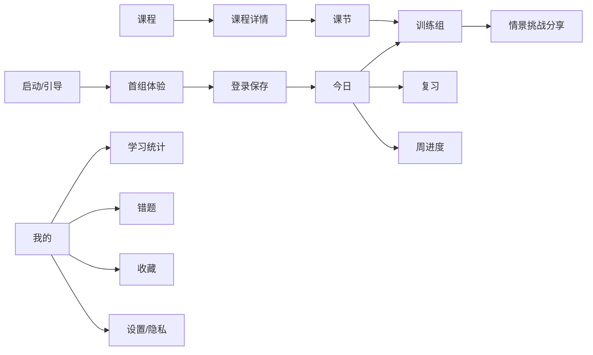

# 03 体验与内容设计

## 1. 体验原则

1. **先练后讲**：先给情景和选择，再解释原则，避免把产品做成文章阅读器。
2. **一组一个目标**：每组只训练一个可迁移原则，不堆叠多个概念。
3. **反馈解释权衡**：沟通题很少有绝对答案，要说明关系、时机和代价。
4. **降低启动成本**：默认内容已准备好，用户不需要先配置复杂计划。
5. **尊重碎片时间**：允许中断、恢复、跳过主动输入，并明确预计时长。
6. **成长而非焦虑**：进度反馈强调积累，不用断签惩罚和社交排名施压。
7. **AI 可见但不喧宾夺主**：让用户知道何处使用 AI，同时核心体验不依赖“聊天”。

## 2. 页面地图



## 3. 关键页面线框说明

### 3.1 今日页

```text
┌──────────────────────────┐
│ 微习                连续 3 天 │
│ 早上好，今天练一个真实场景   │
│                          │
│ ┌ 今日 3 分钟 ──────────┐ │
│ │ 如何拒绝临时任务         │ │
│ │ 边界沟通 · 约 3 分钟      │ │
│ │ [开始今天的练习]          │ │
│ └──────────────────────┘ │
│                          │
│ 待复习  3 题       [去复习] │
│ 本周进度  ● ● ○ ○ ○ ○ ○   │
│                          │
│ 今日        课程        我的 │
└──────────────────────────┘
```

页面首要动作永远只有一个：未完成时开始今日训练，已完成时处理到期复习。课程推荐和运营活动不能挤占首屏主任务。

### 3.2 情景选择卡

```text
┌──────────────────────────┐
│ 2 / 5               × 暂停 │
│ 边界沟通                  │
│                          │
│ 领导临时让你今晚完成材料，   │
│ 但你已有无法调整的安排。      │
│ 你会怎么回复？             │
│                          │
│ A. 今晚不行，明天再说。      │
│                          │
│ B. 好的，我尽量。           │
│                          │
│ C. 我今晚已有安排。可以先确认 │
│    优先级，我先完成关键部分…  │
│                          │
│         [确认选择]         │
└──────────────────────────┘
```

选项文字尽量控制在 2～4 行，不能通过长度、措辞完整度或明显礼貌程度泄露推荐答案。选项顺序在不影响语义时随机化，并记录实际展示顺序。

### 3.3 反馈卡

```text
┌──────────────────────────┐
│ 你的选择：C               │
│ 更推荐                    │
│                          │
│ 为什么                    │
│ · 明确说明了现实边界        │
│ · 主动处理任务优先级        │
│ · 给出了可执行的替代方案     │
│                          │
│ 需要留意                  │
│ 如果任务确属紧急，仍需和对方  │
│ 明确最小交付范围。           │
│                          │
│       [看看表达原则]        │
└──────────────────────────┘
```

反馈先回应用户所选内容，再解释其他选项；不要先展示一个完美答案，让用户感到自己的判断被忽略。

### 3.4 主动表达卡

```text
┌──────────────────────────┐
│ 换你来说                  │
│                          │
│ 同事下午才给出资料，却希望你  │
│ 今天下班前完成全部分析。      │
│                          │
│ [输入你准备回复的一句话……]   │
│ 0 / 200                  │
│ 请勿填写真实姓名或公司机密    │
│                          │
│ [获取点评]       [暂时跳过]  │
└──────────────────────────┘
```

点评出现时保留用户原文，并把“参考改写”放在维度反馈之后，避免暗示只有一种标准说法。

## 4. 每日训练节奏

| 阶段 | 建议时长 | 用户认知任务 |
| --- | ---: | --- |
| 情景理解 | 15～25 秒 | 识别关系、目标与限制 |
| 作出选择 | 20～40 秒 | 比较选项可能造成的结果 |
| 阅读反馈 | 30～50 秒 | 理解优点、风险与条件 |
| 原则提炼 | 15～30 秒 | 记住一个表达结构 |
| 主动表达 | 45～90 秒 | 将原则迁移到相似场景 |
| 完成总结 | 10～20 秒 | 明确所得与下一步 |

不要求所有用户严格在 3 分钟内完成；“3 分钟”是降低启动压力的产品承诺，不应变成倒计时考核。

## 5. 课程结构

```text
课程 Course
└── 章节 Module：一个能力维度
    └── 课节 Lesson：一个明确学习目标
        ├── 新场景 Session
        ├── 变体练习 Session
        ├── 到期复习 Review
        └── 综合模拟 Assessment
```

### 5.1 学习目标写法

每个课节目标使用可观察行为，不写“了解”“认识”等模糊词：

- 好：面对临时任务时，能说明边界、确认优先级并给出替代方案。
- 差：了解如何高情商拒绝领导。

### 5.2 难度递进

| 等级 | 特征 | 示例 |
| --- | --- | --- |
| L1 识别 | 关系简单、信息完整、选项差异明显 | 判断哪个汇报先说结论 |
| L2 权衡 | 存在时间或资源冲突、两个选项都可用 | 协商临时任务优先级 |
| L3 迁移 | 场景变化，用户需要主动组织表达 | 向不同关系对象表达边界 |
| L4 综合 | 多目标、多方关系、不完整信息 | 跨部门延期并推动重新决策 |

MVP 每个课节至少包含 L1、L2 和一次 L3，不以 L4 作为日常高频内容。

## 6. 卡片内容规范

### 6.1 情景结构

每个情景至少包含：

- 关系：直属领导、同事、下属、跨部门伙伴等；
- 目标：拒绝、汇报、催办、确认、争取资源等；
- 限制：时间、职责、资源、信息不完整；
- 触发语或事件；
- 不超过一个需要判断的核心冲突。

情景正文建议 40～120 个汉字。避免真实公司、具体社会事件、刻板印象和无必要的性别设定。

### 6.2 选项设计

三个选项通常对应不同策略，而非“一个正确、两个愚蠢”：

| 类型 | 特征 | 教学作用 |
| --- | --- | --- |
| 回避型 | 没有回应核心任务或只说“尽量” | 解释模糊承诺的风险 |
| 对抗型 | 边界明确但没有承接目标 | 解释关系和协作成本 |
| 建设型 | 说明事实、处理目标、给出下一步 | 展示更完整的表达结构 |

必要时可设计两个条件性可用选项，并在反馈中说明分别适用于什么情况。

### 6.3 反馈模板

```text
结论：更推荐 / 可用但有风险 / 不建议

对方可能如何理解：……
这句话做到了：……
主要风险：……
更适合的条件：……
```

单个选项反馈建议不超过 140 个汉字，先给结论，再给原因。

### 6.4 原则模板

```text
原则名称：协商边界，不做模糊承诺
一句话：先说明客观限制，再确认优先级，最后给出能兑现的下一步。
表达结构：事实 + 影响 + 选择/建议 + 确认
反例：好的，我尽量今天完成。
正例：按当前范围今天无法全部完成。我可以先交付核心部分，其余明早补齐，你希望我优先哪一部分？
```

### 6.5 语言风格

- 使用自然、现代、克制的简体中文；
- 直接称“你”，不用说教式“职场人应该”；
- 不将组织问题全部归因于个人沟通能力；
- 不使用“永远、一定、万能、完美”等绝对词；
- 不评价人格，不进行心理诊断；
- 参考表达可以直接，但不能鼓励欺骗、羞辱、报复或规避合法责任；
- 面对明显不合理或有安全风险的场景，应鼓励寻求正式支持，而不是只优化措辞。

## 7. 内容分类与标签

### 7.1 必填标签

- `skill`：核心技能，如边界沟通；
- `action`：动作，如拒绝、催办、汇报；
- `relationship`：关系；
- `difficulty`：L1～L4；
- `risk_level`：low / medium / high；
- `review_concepts`：进入复习调度的概念；
- `applicable_context`：适用条件；
- `excluded_context`：不适用条件。

### 7.2 高风险内容

以下场景即使属于职场沟通，也必须提高审核等级或不进入 MVP：

- 劳动争议、辞退、赔偿、合同与法律权利；
- 骚扰、歧视、暴力威胁和危机情形；
- 心理健康诊断或自伤相关内容；
- 涉及举报、重大合规或安全事故；
- 要求用户隐瞒事实、伪造数据或规避责任；
- 具体公司的内部事件与可识别个人信息。

这类内容应提示用户保存证据、查看正式制度或寻求专业支持，不用一般沟通技巧替代专业处理。

## 8. 个性化原则

MVP 个性化只做可解释的排序和复习，不做“千人千课”的实时生成：

- 根据用户首选能力调整首周章节顺序；
- 根据错误概念和低评分维度增加相关变体；
- 根据最近学习时间控制每日任务长度；
- 不基于敏感个人属性进行推荐；
- 用户可查看并修改偏好；
- 推荐结果应始终落在已审核内容库内。

## 9. 通知与召回文案

提醒强调明确收益，不制造焦虑：

- 推荐：`今天的 3 分钟场景已准备好：怎样催进度而不显得咄咄逼人。`
- 推荐：`有 3 个表达原则到了复习时间，大约需要 2 分钟。`
- 避免：`你已经 2 天没学习了，再不来就落后了。`
- 避免：`连续记录即将清零！`

## 10. 内容质量检查清单

每组训练发布前必须确认：

- [ ] 学习目标可观察且只有一个；
- [ ] 情景包含足够信息，不依赖编者脑补；
- [ ] 选项不是通过长短或礼貌程度泄露答案；
- [ ] 推荐判断与解释一致；
- [ ] 明确说明适用条件和主要风险；
- [ ] 原则可迁移到至少一个新场景；
- [ ] 主动练习与本课目标一致；
- [ ] 不含人格评价、专业诊断或绝对化承诺；
- [ ] 不要求用户输入敏感信息；
- [ ] 已通过重复度、敏感词和格式校验；
- [ ] 至少一名非作者审核；
- [ ] 在小程序实际尺寸下完成预览。
