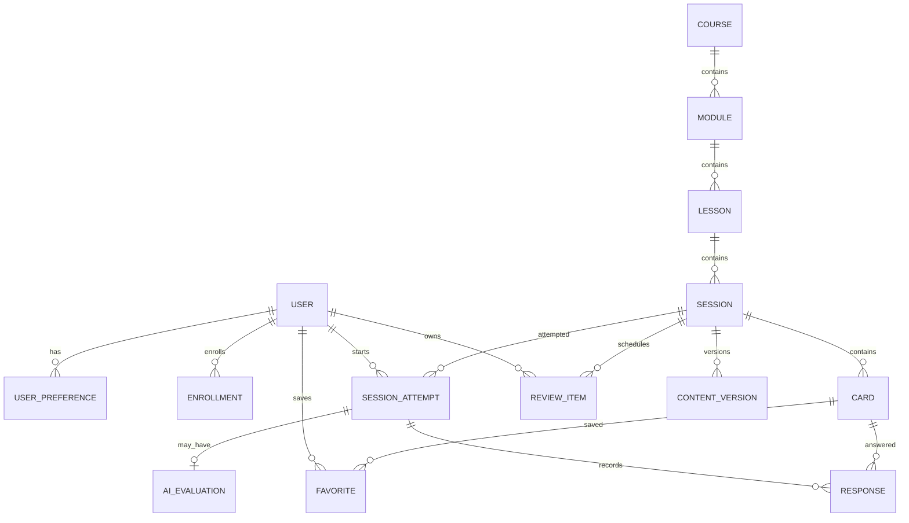
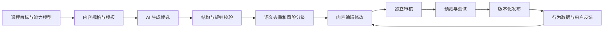

# 04 数据、AI 与指标设计

## 1. 设计目标

数据与 AI 系统需要同时满足四个目标：

1. 支撑课程、作答、进度、复习和内容版本；
2. 让 AI 输出受约束、可评测、可追溯、可降级；
3. 用行为数据判断用户是否真正完成学习闭环；
4. 避免为未来想象过度设计，MVP 保持可实现性。

## 2. 概念数据模型



## 3. 核心实体

| 实体 | 关键字段 | 说明 |
| --- | --- | --- |
| User | id、status、timezone、created_at | 不依赖昵称头像作为核心身份字段 |
| UserPreference | user_id、skill_ids、reminder_opt_in | 偏好可修改，提醒需独立授权 |
| Course | id、title、status、version | 课程容器 |
| Module | course_id、title、sequence | 能力章节 |
| Lesson | module_id、objective、sequence、prerequisite | 可观察的课节目标 |
| Session | lesson_id、title、difficulty、risk_level、status | 一组约 3 分钟训练 |
| Card | session_id、type、payload、sequence | 情景、选择、反馈、原则、主动输入等 |
| Enrollment | user_id、course_id、progress | 用户课程关系 |
| SessionAttempt | user_id、session_id、content_version、status、duration | 一次训练尝试 |
| Response | attempt_id、card_id、selected_option、display_order | 记录实际选项顺序和结果 |
| AIEvaluation | attempt_id、input_ref、rubric_scores、model_version、prompt_version | 结构化点评与追溯信息 |
| ReviewItem | user_id、concept_id、due_at、interval、state | 复习队列 |
| Favorite | user_id、card_id、created_at | 原则卡收藏 |
| ContentVersion | content_id、version、snapshot、reviewer、published_at | 线上内容版本快照 |
| Feedback | user_id、content_version、type、detail、status | 内容纠错与投诉 |

### 3.1 数据规则

- 所有线上作答必须关联内容版本，避免内容更新后无法解释旧数据；
- 完成、提交、收藏等写操作使用客户端生成的幂等键；
- 原始用户表达与 AI 评测结果分开存储，支持单独删除；
- 埋点用户标识与业务主键在分析层做隔离映射；
- 运营报表优先使用聚合数据，不默认展示用户原文；
- 时间同时记录 UTC 时间和用户时区，用于自然日与连续天数计算。

## 4. 训练内容 JSON 示例

```json
{
  "schemaVersion": "1.0",
  "sessionId": "boundary-decline-001",
  "contentVersion": 3,
  "objective": "面对临时任务时，能够说明边界、确认优先级并给出替代方案",
  "skill": "boundary_communication",
  "difficulty": "L2",
  "riskLevel": "low",
  "scenario": {
    "relationship": "manager",
    "context": "下班前，直属领导临时要求你今晚完成一份材料，但你已有无法调整的安排。",
    "question": "你会怎么回复？"
  },
  "options": [
    {
      "id": "a",
      "text": "今晚不行，明天再说吧。",
      "rating": "risky",
      "feedback": {
        "interpretation": "边界明确，但对任务目标缺少承接。",
        "strength": "直接说明了无法加班。",
        "risk": "没有确认紧急程度，也没有提供可执行的下一步。"
      }
    },
    {
      "id": "b",
      "text": "好的，我尽量今晚完成。",
      "rating": "not_recommended",
      "feedback": {
        "interpretation": "对方可能理解为你已承诺完成。",
        "strength": "表达了配合意愿。",
        "risk": "承诺模糊，既没有说明限制，也无法管理交付预期。"
      }
    },
    {
      "id": "c",
      "text": "我今晚已有无法调整的安排。可以先确认优先级，我先完成最关键的部分，其余明早补齐，可以吗？",
      "rating": "recommended",
      "feedback": {
        "interpretation": "在说明边界的同时，继续承接任务目标。",
        "strength": "包含限制、优先级和替代方案。",
        "risk": "若任务涉及紧急事故，仍需进一步确认最小交付范围。"
      }
    }
  ],
  "principle": {
    "title": "协商边界，不做模糊承诺",
    "summary": "事实 + 优先级 + 可兑现的下一步",
    "reviewConcepts": ["state_constraint", "confirm_priority", "offer_next_step"]
  },
  "practice": {
    "prompt": "同事下午才给出资料，却希望你今天下班前完成全部分析。请写一句回复。",
    "rubricId": "boundary-v1"
  },
  "applicableContext": ["常规任务协商"],
  "excludedContext": ["安全事故", "法律争议", "紧急危机"]
}
```

## 5. AI 能力边界

### 5.1 AI 适合承担

- 按课程目标生成候选情景和变体；
- 生成具有教学价值的错误选项；
- 按指定语气和长度改写；
- 对用户表达按固定 rubric 输出结构化点评；
- 生成复习变体；
- 检测候选内容的语义重复；
- 给内容编辑提供修改建议。

### 5.2 AI 不独立决定

- 课程能力模型和学习顺序；
- 哪个回答在所有情况下“唯一正确”；
- 内容是否达到发布标准；
- 专业法律、医疗、金融和心理建议；
- 用户人格、情商、职级潜力等推断；
- 线上内容的自动发布和高风险内容的自动放行。

## 6. 内容生产流水线



### 6.1 自动校验

- JSON Schema 完整性；
- 文本长度与卡片数量；
- 选项 ID、评分与反馈一一对应；
- 至少一个推荐项，且不超过两个；
- 推荐项不能总是最长或固定在同一位置；
- 原则与 rubric 使用同一技能概念；
- 敏感内容和高风险关键词；
- 与已有内容的语义相似度；
- 输出是否包含绝对化、人格评价或不当承诺。

自动校验只能拦截明显问题，不能代替人工判断。

### 6.2 审核级别

| 风险 | 示例 | 审核要求 |
| --- | --- | --- |
| 低 | 常规进度确认、会议表达 | 一名非作者审核 |
| 中 | 向上拒绝、绩效反馈、资源冲突 | 两名审核者或领域负责人批准 |
| 高 | 劳动争议、骚扰、危机、法律权利 | MVP 不发布；后续需专业审核与专项规则 |

## 7. AI 点评接口契约

输入只包含当前情景、rubric、必要课程上下文和用户当次表达，不发送无关画像或历史原文。

建议结构化返回：

```json
{
  "result": "success",
  "rubricVersion": "boundary-v1",
  "dimensions": [
    {
      "key": "states_constraint",
      "level": "met",
      "reason": "明确说明了今天无法完成全部工作的现实限制。"
    },
    {
      "key": "offers_next_step",
      "level": "partial",
      "reason": "提出了明天完成，但还可以明确今天能够先交付什么。"
    }
  ],
  "summary": "边界清楚，可以把下一步说得更具体。",
  "rewrite": "按目前资料，今天无法完成全部分析。我可以先输出核心结论，完整版本明天上午补齐，可以吗？",
  "safety": {
    "allowed": true,
    "reasonCode": null
  }
}
```

服务端必须校验字段枚举、数量和长度，不将未经校验的模型原文直接渲染给用户。

## 8. AI 质量评测

公测前建立至少 100 条匿名化测试样本，覆盖：

- 清晰、高质量表达；
- 边界明确但语气强硬；
- 很礼貌但没有下一步；
- 与场景无关的回答；
- 极短、重复、乱码；
- 含个人信息或公司机密倾向；
- 诱导模型做心理/法律判断；
- 提示词注入和要求忽略规则；
- 不同关系和同一原则的变体。

评测维度：

| 维度 | 判断 |
| --- | --- |
| 相关性 | 是否只评价当前学习目标 |
| 一致性 | 相似输入的维度判断是否稳定 |
| 可执行性 | 建议是否具体且能直接理解 |
| 克制性 | 是否避免人格评价和绝对化结论 |
| 安全性 | 是否拒绝不当推断、保护隐私 |
| 格式合规 | 是否稳定通过结构校验 |
| 延迟与成本 | P50/P95 延迟和单次平均成本是否达标 |

每次更换模型、系统提示词或 rubric 版本，都应回归同一评测集并保留结果。

## 9. 推荐与复习算法（MVP）

### 9.1 今日训练选择

按以下顺序决定：

1. 未完成的当前训练；
2. 当前课程中已解锁的下一课节；
3. 用户首选技能对应的同层级训练；
4. 最近薄弱概念的已审核变体；
5. 默认课程顺序。

同一技能连续出现不超过 3 天；不要为了“个性化”打乱必要的课程前置关系。

### 9.2 掌握度（简化）

MVP 不建立不可解释的复杂总分。每个概念只维护：

- 最近结果；
- 连续正确次数；
- 最近练习时间；
- 当前复习间隔；
- 是否由用户主动标记未掌握。

周报告中的“较稳定/建议练习”由这些可解释数据生成，不宣称精确测量真实能力。

## 10. 埋点设计

### 10.1 通用字段

- `event_id`：事件唯一 ID；
- `occurred_at`：客户端发生时间；
- `received_at`：服务端接收时间；
- `anonymous_or_user_id`：匿名或登录分析标识；
- `session_id`：一次小程序访问会话；
- `app_version`、`platform`、`network_type`；
- `course_id`、`lesson_id`、`training_session_id`、`content_version`（适用时）；
- `experiment_id`、`variant_id`（适用时）。

### 10.2 核心事件

| 事件 | 触发时机 | 关键属性 |
| --- | --- | --- |
| app_open | 小程序进入前台 | source、share_id |
| onboarding_view | 引导首屏可见 | is_first_visit |
| preference_submit | 提交偏好 | selected_skills、skipped_fields |
| training_view | 训练组可见 | entry、is_resume |
| card_view | 卡片有效展示 | card_type、sequence |
| option_select | 用户确认选项 | option_id、display_position、rating |
| feedback_expand | 查看其他选项反馈 | option_id |
| principle_favorite | 收藏/取消原则 | action、concept_id |
| practice_submit | 提交主动表达 | input_length、rule_check_result |
| ai_evaluation_result | 点评完成或降级 | status、latency_ms、model_version |
| training_complete | 完成训练组 | duration_ms、practice_used |
| review_start | 开始复习 | due_count、entry |
| review_answer | 完成复习题 | result、interval_before |
| share_initiate | 发起分享 | share_type、content_id |
| share_land | 从分享进入 | share_id、source_user_bucket |
| content_feedback | 提交纠错/投诉 | type、content_version |
| login_result | 登录结果 | trigger、status |

禁止把用户原始主动表达作为埋点属性上传。

## 11. 指标口径

### 11.1 核心漏斗

```text
首次打开
→ 看到引导
→ 开始首组训练
→ 完成首次选择
→ 完成首组训练
→ 登录保存
→ 次日再次训练
→ 7 日内至少训练 3 天
```

### 11.2 核心指标定义

| 指标 | 口径 |
| --- | --- |
| 首训开始率 | 首次访问后 24 小时内开始训练的设备/用户 ÷ 首次访问设备/用户 |
| 首训完成率 | 完成首组训练的用户 ÷ 开始首组训练的用户 |
| D1 留存 | 首训完成次日再次产生有效学习行为的用户 ÷ 当日首训完成人数 |
| 7 日三练率 | 首训后 7 个自然日内，在 ≥3 天有有效学习行为的用户占比 |
| 主动练习率 | 提交主动表达的训练次数 ÷ 含主动表达卡的已完成训练次数 |
| 复习到期完成率 | 到期后 48 小时内完成的复习项 ÷ 到期复习项 |
| 内容退出率 | 在某卡片后退出且 24 小时未恢复的训练次数 ÷ 该卡片有效展示次数 |
| 分享答题转化 | 分享落地后完成挑战答题人数 ÷ 分享落地人数 |
| WEL | 一周内 ≥3 个自然日训练，且完成 ≥1 次复习或主动表达的去重用户数 |

“有效学习行为”定义为完成正式训练组或至少 2 个到期复习项；仅打开首页不计入。

## 12. 实验原则

- 优先实验首次引导长度、每日训练结构、反馈密度、主动输入时机；
- 同期只改变一个主要假设；
- 课程内容实验必须记录内容版本，避免把内容差异误判为交互效果；
- 不对安全规则、隐私说明和必要授权做弱化实验；
- 小样本阶段结合访谈和会话回放，不只看显著性；
- 实验结束预先定义停止条件和采用条件，避免只挑有利指标。
